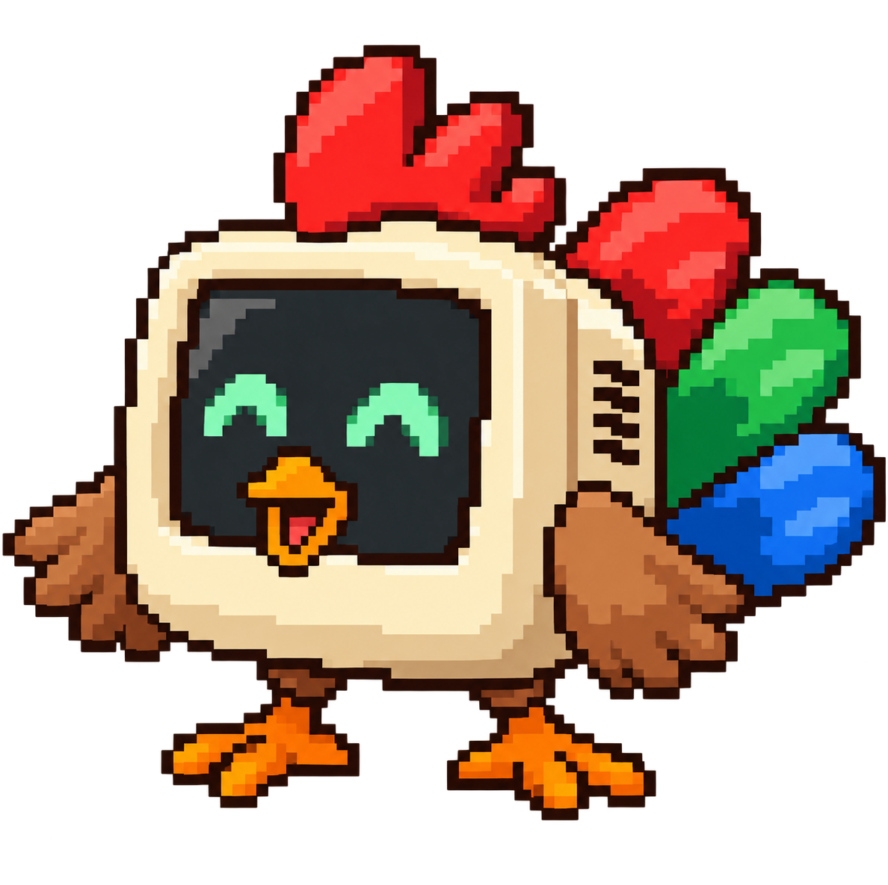
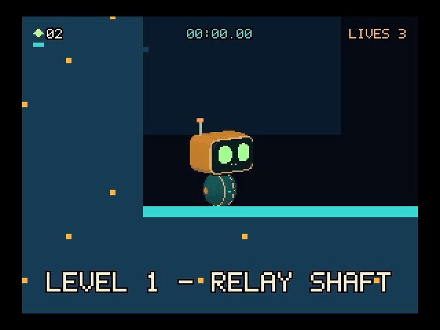

<h1 align="center">
   Chirky
</h1>

Chirky is a small games console written in C for **Raspberry Pi/Linux and
desktop/mobile browsers**. Both targets share the same games, console menus,
renderer and portable runtime. It is an experiment in responsive, low-resolution
games, with four unfinished games to explore and extend.

**[Play in your browser](https://chirky.org/)** ·
[Architecture](docs/architecture.md) · [Game API](docs/platform-api.md)

The idea came from playing the original Mario on a NES while visiting family
in France: could I recreate that smooth, immediate feeling on today's hardware?
My Chirky Box runs on a Raspberry Pi 3B+ connected to a CRT through a SCART HAT,
with a SNES controller wired to a Raspberry Pi Pico as a USB joystick.
You can also build and play the browser version without any of that hardware.

<a href="https://chirky.org/?game=phosphor-run"></a>

## What is here

- A shared console with a game launcher, pause menu and remappable controls.
- Native shared game modules on the Pi and WebAssembly side modules in the
  browser, using the same C game API.
- A 320×240 framebuffer with a default 288×216 CRT-safe playable area.
  The browser preserves the 4:3 display with nearest-neighbour presentation.
- Keyboard and gamepad input on both targets, plus browser touch controls and
  mobile Home Screen launch.
- A local Node.js dashboard for editing game data, browser playtesting and
  deploying source/assets to one configured Pi over SSH/SCP.

The installed Pi runs independently of the dashboard. The public browser site
is a standalone static build; the dashboard is a local development tool.

| Icon | Game | Current state |
| --- | --- | --- |
|  | [Phosphor Run](games/phosphor-run/README.md) | Platformer with wall-jumps, dashes, checkpoints, signal shards and device-local high scores |
|  | [Rosey Chop](games/rosey-chop/README.md) | Garden game about chopping dead roses and dodging wasps before a storm |
|  | [Bramble Hollow](games/bramble-hollow/README.md) | Woodland adventure proof of concept with gardening, dialogue, cycling and an optional world director |
| — | [Circuit Clash](games/circuit-clash/README.md) | Local two-player fighter prototype with device joining and rematches |

All four games are works in progress. Bramble's optional
[director service](director/README.md) supplies asynchronous world state;
the game remains playable without it. Global leaderboards, public content
submissions and network multiplayer are future work described in the
[platform evolution plan](docs/platform-evolution.md).

## Build and play in a browser

From a checkout, install **Make, Python 3, Node.js 22 or newer**, and the
official Emscripten SDK pinned in [`.emscripten-version`](.emscripten-version).
The [browser setup guide](web/README.md#build-and-run) has SDK installation
commands and explains how to use an existing installation. The build verifies
the compiler version.

Run from the repository root:

```sh
make web
node tools/serve-web.cjs
```

Open <http://127.0.0.1:3031/>. This serves the standalone site from `build/web/`
without needing a Pi or dashboard. Re-run `make web` after changing code or
assets to refresh that build.

On Windows, install the SDK in WSL and use `wsl make web NODE=node.exe`, then
run the preview server with Windows Node.js. See the
[browser guide](web/README.md) for mobile/LAN previews and
[web deployment](deploy/WEB.md) for publishing.

### Basic controls

| Action | Keyboard (player 1) | Default SNES controller |
| --- | --- | --- |
| Move | Arrow keys | D-pad |
| Primary / select | N | B |
| Secondary / back | M | Y |
| Start | Enter | Start |
| Menu / pause | Escape | Select |

Player 2 uses WASD and F/G, sharing Enter and Escape. Configure keyboards and
controllers under **Settings > Input Settings**; on-screen prompts follow saved
bindings. Browser touch controls appear on mobile. See the
[console guide](docs/console-guide.md) for remapping, input testing and CRT
calibration, and each game's README for its actions.

## Edit games with the dashboard

From the repository root:

```sh
node dashboard/server.js
```

Open <http://127.0.0.1:3030/>. The dashboard has no third-party runtime
dependencies. It edits files in your checkout and works with the Pi offline.
All games expose settings; level and sprite editors appear where a game
provides an editor description.

After `make web`, open <http://127.0.0.1:3030/play/> or use **Play in browser**
from an editor. This player reads working-tree assets: save and restart the
game to see data changes. C changes still require `make web`.

For Pi administration, override `host`, `user`, `remoteRoot` and optional
`identityFile` in the gitignored `dashboard/config.local.json`; defaults are in
[`dashboard/config.json`](dashboard/config.json). SSH/SCP and working key-based
SSH access are required. **Install project on Pi** copies and builds the project,
then restarts the console. See the [console guide](docs/console-guide.md#dashboard-and-pi-administration)
for launcher editing, snapshots and other Pi controls.

## Build and run on a Pi

Start with the [Pi provisioning guide](provision/README.md) for the tested
Raspberry Pi OS Lite image, packages, hardware permissions, RGBerry display
timings and automatic startup. Its supplied card/install workflow uses
PowerShell on Windows.

On a configured Pi, from the checkout root:

```sh
make
./build/chirky-host
```

`make` builds the host and all native game modules. The native host uses
DRM/KMS, GBM/EGL and OpenGL ES directly, with evdev input and ALSA audio.
It needs access to the display and input devices; this is a Linux console
application without a desktop window system. Use the browser build for
desktop play on macOS or Windows.

The native build links versioned DRM/Mesa runtime libraries; provisioning
installs these and the C build tools. Rebuild the host and games together when
the game ABI changes. Once installed as a service, the Pi boots to the launcher
by default and needs no development computer attached.

## Find your way around

| Location | Responsibility |
| --- | --- |
| [`include/chirky.h`](include/chirky.h) | Game-facing C API and ABI version |
| [`src/`](src/) | Shared console, game lifecycle, rendering and assets |
| [`src/platform/linux/`](src/platform/linux/) | Native devices, module loading, networking and persistence |
| [`src/platform/web/`](src/platform/web/), [`web/`](web/) | Emscripten bridge and browser input, presentation and services |
| [`games/`](games/) | Game code, manifests, settings and assets |
| [`dashboard/`](dashboard/) | Local editors, browser playtesting and Pi administration |
| [`director/`](director/) | Optional Bramble world service |
| [`tools/`](tools/), [`tests/`](tests/) | Build tools, asset pipelines and validation |
| [`deploy/`](deploy/), [`provision/`](provision/) | Static-site publication and Pi installation |

To add a game, start with the [game folder guide](games/README.md) and
[game API](docs/platform-api.md). Games export `chirky_game_entry()` and use
host callbacks for input, drawing, audio, assets and optional services.
Builds discover `games/*/game.c`; adjacent `game.conf` files provide the catalog
metadata, so there is no central game list to edit.

Keep game and core code portable, with operating-system and browser APIs in
their platform adapters. Draw within the host's reported logical viewport;
the host owns CRT margins and offsets. See [architecture](docs/architecture.md)
for ownership and [artwork guidance](games/ARTWORK.md) for asset requirements.

## Validate changes

On Linux/Pi or in WSL, with the native build dependencies installed:

```sh
make test
make web
```

On Windows, use `wsl make test NODE=node.exe` and `wsl make web NODE=node.exe`.
The regression suite covers games, the shared console, assets, input, dashboard
and browser packaging without requiring a live Pi or access to DRM/input
devices. It includes Linux-specific tests, so the full suite is not a native
macOS test command.

For rendering or catalog changes, also select the affected games through the
launcher and inspect them in the browser; a successful build alone does not
verify appearance or integration. The [browser guide](web/README.md#test-and-publish)
describes the Chrome integration checks. For native performance work, see
[live profiling and the timing overlay](docs/live-profiling.md) and
[Pi benchmark measurements](docs/performance-pi3.md).
